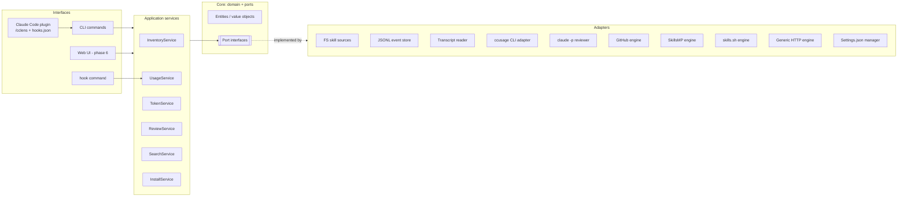

# cclens: Architecture

Hexagonal (ports and adapters). The **core** is plain domain logic behind interfaces. **Adapters** implement those interfaces for the file system, ccusage, Claude Code, and the skill registries. One **composition root** connects them, and the CLI, hooks, and (later) the web UI are thin **interfaces** on top.



## Folder layout

```
cclens/
├─ src/
│  ├─ core/                     # NO I/O. Pure TS.
│  │  ├─ domain/                # Skill, SkillRef, UsageEvent, TokenUsage, Session,
│  │  │                         # Recommendation, SearchResult, EngineDescriptor
│  │  ├─ ports/                 # interfaces (below)
│  │  ├─ rules/                 # OptimizationRule implementations (pure)
│  │  ├─ search/                # ResultAggregator, RankingStrategy, Deduper
│  │  └─ errors.ts              # typed error hierarchy (CclensError → ConfigError, EngineError…)
│  ├─ app/                      # use-case services, depend only on core/ports
│  ├─ adapters/
│  │  ├─ claude/                # settings manager, transcript reader, skill sources, claude -p
│  │  ├─ storage/               # JSONL event store, file cache, config store
│  │  ├─ tokens/                # ccusage adapter
│  │  └─ engines/               # github/, skillsmp/, skillsh/, generic-http/
│  ├─ interfaces/
│  │  ├─ cli/                   # commander commands, one file per command
│  │  ├─ hook/                  # stdin payload → UsageService
│  │  └─ render/                # TableRenderer, JsonRenderer, MarkdownRenderer
│  └─ composition-root.ts       # the only place that does `new Adapter()`
├─ plugin/                      # Claude Code plugin: .claude-plugin/plugin.json,
│                               # hooks/hooks.json, commands/cclens.md, skills/cclens/SKILL.md
├─ .claude-plugin/marketplace.json
├─ test/ (unit/, contract/, fixtures/)
└─ docs/ (PLAN.md, ARCHITECTURE.md, adr/)
```

Dependency rule: `interfaces → app → core ← adapters`. ESLint `import/no-restricted-paths` enforces it, so `core` can never import from `adapters`.

## Ports (interfaces)

```ts
// Inventory (R1). Composite: many sources merged into one list
interface SkillSource {
  readonly id: string; // "personal" | "project" | "plugin:<name>"
  list(): Promise<Skill[]>;
}

// Usage (R2)
interface UsageEventStore {
  // append-only
  append(e: UsageEvent): Promise<void>;
  query(f: UsageFilter): AsyncIterable<UsageEvent>;
}
interface UsageHistorySource {
  // backfill from transcripts / legacy log
  read(since?: Date): AsyncIterable<UsageEvent>;
}

// Tokens (R3)
interface TokenUsageProvider {
  byPeriod(p: 'day' | 'week' | 'month', f: TokenFilter): Promise<TokenBucket[]>;
  bySession(f: TokenFilter): Promise<SessionTokens[]>;
  blocks(): Promise<UsageBlock[]>; // 5-hour windows
}

// Review (R4). Strategy pattern
interface OptimizationRule {
  readonly id: string;
  readonly severity: 'info' | 'warn' | 'high';
  evaluate(ctx: ReviewContext): Recommendation[]; // pure, no I/O
}
interface AiReviewer {
  // optional, behind --ai
  review(summary: ReviewSummary): Promise<Recommendation[]>;
}

// Search (R5)
interface SkillSearchEngine {
  readonly descriptor: EngineDescriptor; // id, name, requiresKey, rateLimit
  search(q: SearchQuery, signal: AbortSignal): Promise<SearchResult[]>;
}
interface RepoMetadataProvider {
  // star enrichment (GitHub)
  enrich(repos: RepoRef[]): Promise<Map<string, RepoMeta>>;
}
interface RankingStrategy {
  rank(r: SearchResult[], q: SearchQuery): SearchResult[];
}

// Infrastructure
interface ClaudeSettingsManager {
  // R6
  read(scope: Scope): Promise<ClaudeSettings>;
  applyHooks(plan: HookPlan): Promise<Backup>; // atomic + backup
  restore(b: Backup): Promise<void>;
}
interface ConfigStore {
  load(): Promise<Config>;
  save(c: Config): Promise<void>;
}
interface Cache {
  get<T>(k: string): Promise<T | undefined>;
  set<T>(k: string, v: T, ttl: number): Promise<void>;
}
interface Clock {
  now(): Date;
} // keeps tests deterministic
interface Renderer<T> {
  render(data: T): string;
}
```

## Design patterns and where they're used

| Pattern                  | Where                                                                 | Why                                                                                  |
| ------------------------ | --------------------------------------------------------------------- | ------------------------------------------------------------------------------------ |
| **Ports & Adapters**     | Whole system                                                          | Swap ccusage, registries, or storage without touching logic; easy to test with fakes |
| **Composite**            | `CompositeSkillSource` merges personal/project/plugin sources         | One inventory API across any number of sources                                       |
| **Strategy**             | `OptimizationRule`, `RankingStrategy`, `Renderer`                     | Add a rule, ranking, or output format without editing existing code (open/closed)    |
| **Registry + Factory**   | `EngineRegistry` builds engines from `config.engines[]` by `type`     | Enable, disable, or add engines from config; third-party engine types can register   |
| **Adapter**              | Each registry engine maps its API → `SearchResult`                    | The core never sees vendor JSON                                                      |
| **Decorator**            | `CachedEngine`, `TimeoutEngine`, `RateLimitedEngine` wrap any engine  | Cross-cutting behaviour without changing the engines themselves                      |
| **Template Method**      | `HttpSearchEngine` base: build request → fetch → validate (zod) → map | Shared HTTP flow; each subclass implements only `buildRequest` and `map`             |
| **Command (with undo)**  | Install steps: `BackupSettings`, `MergeHooks`, `MigrateLegacyLog`…    | `init` runs them in order; `uninstall` and failure rollback undo them in reverse     |
| **Dependency Injection** | `composition-root.ts`                                                 | No hidden `new` calls in services; the test root injects fakes                       |

## Key flows

**Hook capture (hot path, < 150 ms):** Claude Code → `cclens hook post-tool-use` → zod-parse the stdin payload → `UsageService.record()` → `JsonlEventStore.append()` → exit 0. Errors go to `~/.cclens/hook-errors.log`; the hook never throws back at Claude.

**Search:** `SearchService.search(q)` → `EngineRegistry.enabled()` → run all engines in parallel with `Promise.allSettled`, each wrapped in Timeout + Cache decorators → `ResultAggregator` (normalize the repo URL → dedupe → `RepoMetadataProvider` adds stars) → `RankingStrategy` (default: stars × relevance) → renderer. Failed engines show up as warnings in the output, not as errors.

**Adding an engine without code:** `cclens engines add --from-file my-engine.json`, using the `generic-http` type:

```json
{
  "id": "my-registry",
  "type": "generic-http",
  "enabled": true,
  "request": {
    "url": "https://example.com/api/search?q={query}&limit={limit}",
    "headers": { "Authorization": "Bearer ${env:MY_KEY}" }
  },
  "response": {
    "items": "$.data.skills",
    "map": {
      "name": "$.name",
      "description": "$.description",
      "repoUrl": "$.github_url",
      "stars": "$.stars"
    }
  }
}
```

**Review:** `ReviewService` builds a `ReviewContext` (token buckets, session stats, inventory, usage counts, context-overhead estimates) → runs every enabled `OptimizationRule` → sorts by estimated savings → optional `AiReviewer` (`claude -p` sees only the summary, never your raw transcripts) → renderer.

### First rule set

| Rule                          | Fires when                                       | Suggests                                                             |
| ----------------------------- | ------------------------------------------------ | -------------------------------------------------------------------- |
| `unused-skills`               | Skill/plugin unused for ≥ 30 days                | Uninstall or disable the plugin; shows the tokens it costs per reply |
| `heavy-mcp-overhead`          | MCP tool definitions take > 10K tokens           | Disable connectors not used in the period                            |
| `long-sessions`               | Cache reads grow past a threshold in one session | Start new sessions per task, use `/clear` or `/compact`              |
| `expensive-model-for-routine` | Scheduled or repeated tasks run on the top model | Use Sonnet or Haiku, or lower effort                                 |
| `near-plan-limit`             | Weekly window ≥ 80%                              | Pace work and point to the heaviest projects                         |
| `frequent-compaction`         | Many auto-compacts in a session                  | Split the work into several sessions                                 |

## Data and config

```
~/.cclens/
  config.json        # engines, thresholds, enabled rules (zod-validated, versioned for migrations)
  events.jsonl       # {v:1, ts, source:"auto"|"typed"|"backfill", skill, plugin?, project, sessionId}
  cache/             # search + star cache with TTL
  backups/           # settings.json snapshots made by init
  hook-errors.log
```

Override the location with `CCLENS_HOME`. Respect `CLAUDE_CONFIG_DIR` for Claude Code's own data directory.
